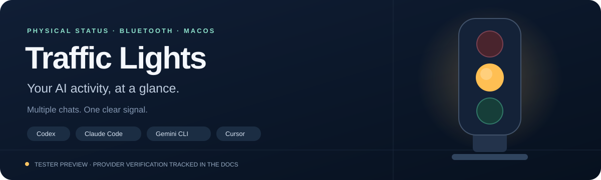

# Traffic Lights

A Bluetooth desk light for your local AI agents. See when work is running, when attention is needed, and when your tracked chats have finished—without watching every window.

**Native desktop tester preview** · Mac verified · Windows acceptance pending · Linux unsupported

nRF52840 hardware · OLED reactions · Working-session count · Local provider icons

[Public customer setup](https://github.com/alfonsoforcen3/TrafficLights_Setup) · [Install and activate: Mac / Windows / Linux status](docs/INSTALL_ACTIVATE.md) · [Factory/maintainer installation](INSTALL.md) · [Provider integrations](docs/PROVIDERS.md) · [Documentation](docs/README.md) · [Release readiness](docs/RELEASE_READINESS.md)

## One light, all your tracked chats

| Signal | Meaning |
| :--- | :--- |
| 🟢 Green | All tracked chats are ready or finished |
| 🟡 Amber | At least one chat is working |
| 🔴 Blinking red | A supported input or permission request needs attention |
| 🔴 Solid red | An explicit error signal was received |

Each chat has a separate provider/session record. The shared light prioritizes **input → error → working → ready**. Finishing one chat leaves the light amber while another is working. Green settles for 1.5 seconds after completion; brief input signals are filtered for 0.8 seconds. [How multiple chats work →](docs/MULTIPLE_CHATS.md)

## Set up a pre-flashed light

### Private customer onboarding candidate

The new terminal flow discovers a powered toy over Bluetooth without USB data,
checks its firmware identity, asks for a nickname, and configures selected local
provider hooks. Persistent naming requires factory-updated firmware; older units
can keep their existing advertisement. Start with `python3 install.py --onboard`.
See [customer setup](docs/CUSTOMER_SETUP.md) and [customer agent instructions](docs/CUSTOMER_AGENT.md).
This candidate stays private until the owner approves release and physical
acceptance passes. A clean distribution bundle can be prepared using
`python3 scripts/build_customer_bundle.py`; it does not publish anything.

### Private virtual companion prototype

The [native macOS prototype](desktop/macos/README.md) displays traffic lights,
reported WIP and AI apps in the menu bar. It observes an already-running local
companion without starting hardware or installing hooks. Demo data and the
floating island are explicit options. This is a private development build, not a
customer-ready app. See the [design and acceptance plan](docs/VIRTUAL_CLAWDY_PLAN.md).

The [private Windows tray prototype](desktop/windows/README.md) brings the same
traffic lights and hover/attention card to WPF. Its build and portable fixtures
are tested separately from [native Windows acceptance](docs/windows/VIRTUAL_CLAWDY_ACCEPTANCE.md),
which still requires a Windows laptop. It is not installed by the physical-device installer.

### Existing maintainer/tester installation

The source workflow below requires authorized access to this private repository. Customer documentation lives in [TrafficLights_Setup](https://github.com/alfonsoforcen3/TrafficLights_Setup); a standalone signed consumer installer is still pending.

Boards should ship wired, flashed, tested, and labelled with their Bluetooth name. Testers install the native Mac or Windows companion and approve local access; routine operation needs no USB data connection.

```bash
git clone https://github.com/alfonsoforcen3/TrafficLights_Arduino.git
cd TrafficLights_Arduino
python3 install.py --ble-name TrafficLight-ABCD
```

Replace `TrafficLight-ABCD` with **your unit's label**. The installer creates an isolated Python environment, installs the Bluetooth login helper, detects supported local AI tools, and preserves unrelated hooks/settings. Approve Bluetooth access for **Traffic Light Bridge** and review each provider's hooks/workspace trust. Then check:

```bash
python3 manage_hooks.py status
```

Prefer an agent-assisted installation? Give your agent this prompt:

> Clone https://github.com/alfonsoforcen3/TrafficLights_Arduino.git. Read AGENTS.md, INSTALL.md and docs/PROVIDERS.md. Install the macOS Bluetooth companion for my pre-flashed unit using the Bluetooth name on its label. Show detected providers, preserve existing settings and disabled-hook preferences, and explain required access approvals. Verify BLE acknowledgements and ask me to confirm the physical lights. Skip firmware flashing unless this is a factory, DIY or recovery unit.

For unflashed units, USB name discovery, prerequisites and recovery, use the [full installation guide](INSTALL.md).

## Local integrations

| Application | Adapter | Verification |
| :--- | :--- | :--- |
| Codex / locally orchestrated Work | Prompt, tools, input, completion, explicit errors | Real hooks and prototype BLE verified |
| Claude Code | Prompt, tools, permission/questions, completion, failed turns | Installed here; payload/mixed-session tests pass; live turn acceptance pending |
| Gemini CLI | Agent/model/tools, permission notifications, completion | Installer and payload tests pass; live CLI acceptance pending |
| Cursor Agent | Prompt, thought/response, completion/errors | Installer and payload tests pass; live app acceptance pending; no permission-wait signal |

This integrates with **applications**, regardless of their underlying model. Ordinary AI websites and cloud agent VMs do not automatically reach this local bridge. [Adapter capabilities, access review, and custom integrations →](docs/PROVIDERS.md)

## Useful commands

```bash
python3 scripts/provider_setup.py --detect               # Preview detected applications
python3 install.py --providers codex claude               # Restrict hook installation
python3 install.py --no-hooks                             # Update the helper, preserve hooks
python3 manage_hooks.py status                            # Sessions, connection and GPIO report
python3 manage_hooks.py disable                           # Remove owned hooks and login service
```

The explicit hardware colour test is `python3 scripts/verify_hardware.py`. It deliberately cycles the LEDs; run it during setup or diagnostics, not during ordinary conversations. Removal retains recovery backups, runtime packages and flashed firmware. [Troubleshooting →](docs/TROUBLESHOOTING.md)

## Inside the repository

| Path | Purpose |
| :--- | :--- |
| `install.py` / `manage_hooks.py` | Setup and operator commands |
| `scripts/` | Provider adapters, local bridge, Bluetooth helper and provisioning |
| `firmware/nicenano/` | Tested nRF52840/CircuitPython board profile |
| `firmware/traffic_light/` | Legacy Arduino wired profile |
| `docs/` | Customer, factory, tester and developer guides |
| `tests/` | Hardware-free regression coverage |

[Contributing](CONTRIBUTING.md) · [Security and privacy](SECURITY.md) · [Changelog](CHANGELOG.md) · [Commercial distribution and source policy](docs/COMMERCIAL.md)

## Before commercial release

This is a working **tester preview**, not a completed consumer release. Battery charging/current and endurance, repeated battery cycles, clean-Mac onboarding, full Mac reboot, live additional-provider acceptance, signed/notarized packaging and device enrollment remain release gates. [Track the evidence and remaining work →](docs/RELEASE_READINESS.md)

The verified prototype uses a nice!nano-compatible clone with **P0.10 green, P1.11 amber, P1.13 red**. Confirm the exact board's battery/charger specifications before applying genuine nice!nano guidance. [Hardware](docs/HARDWARE.md) · [Battery wiring and charging](docs/BATTERY.md)

The owner has selected private implementation plus public setup/docs and a signed installer. This checkout is for authorized maintainers/testers; the consumer installer is not yet available. No open-source license is supplied; dependencies retain their own terms. See [commercial policy options](docs/COMMERCIAL.md).

The Mac preview includes a [Clawdy website and real battery sensor dashboard](docs/WEBSITE_BATTERY.md). Battery percentage requires verified calibration; charging status is not inferred.
