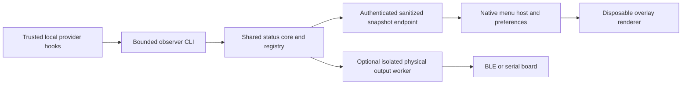

# Virtual Clawdy: desktop companion plan

**Private planning draft · 20 October 2026 · no implementation authorized by this document**

The owner subsequently authorized a private macOS prototype on 20 October 2026.
Its [build instructions and current boundaries](../desktop/macos/README.md) are
separate from this design. This document remains a proposed release architecture;
the prototype does not establish every acceptance target below.
The owner then chose a much smaller, top-center island below the camera, with
the light post horizontal. That direction supersedes the initial corner-anchor
visual proposal below; retain the same safety, privacy and recovery boundaries.
The latest preference is menu-bar-only traffic lights, with no floating island
by default. The island is optional; the default observer preserves reported
colours while qualifying confidence separately. See the acceptance record for
current implementation evidence rather than treating the earlier visual plan
as the active default.

## 1. Decision and scope

Build a small, floating Clawdy for **macOS first**, using native Swift/AppKit
for windows and sprite animation, with the existing Python status pipeline as
the shared source of truth. A board must be optional. Preserve the physical
product's status meanings, working-session count, provider indicators and funny
phrases. Future Windows support should consume the same versioned status
contract, with a separately tested native desktop shell.

The engineering objective is failure containment and visible recovery, not
“zero crashes.” No virtual app exists or has been benchmarked by this planning
work. All numeric budgets below are **proposed acceptance targets, not results**.
No hooks, services, Bluetooth connections, firmware or public assets are changed
by this plan. Publication and installation require a later owner assignment.

### First private version

- One compact mascot, a WIP badge, optional speech bubble, and menu-bar controls.
- Drag/reposition through an explicit move mode; normal operation does not steal
  focus. Easy hide, pause, reduced-motion and quit controls.
- Local Codex, Claude Code, Gemini CLI and Cursor signals only where their hooks
  are configured and trusted. A browser ChatGPT tab is not a supported signal.
- Virtual-only mode with no serial/BLE imports, scans, toy prerequisite or
  Bluetooth permission prompt. Physical-only and both modes remain explicit.
- No chat interface, model requests, screen reading, input automation, global
  keyboard monitoring, task text, cloud synchronization or automatic purchases.
- No roaming physics, 3D engine, plugin marketplace or arbitrary downloaded art
  in the first version. A gentle hover at a fixed anchor gives the intended feel.

## 2. Repository evidence and gaps

Read-only inspection baseline: **512ecc8**, `Avoid Windows stdin pipe deadlocks
in status hooks`. These are source observations, not live-runtime measurements.

| Existing component | Reuse | Change required before a virtual release |
| --- | --- | --- |
| `scripts/traffic.py` | Provider normalization and observer-only behavior; stdin has a 0.2 s budget and TCP operations a 0.15 s timeout; no direct USB fallback or prompt logging | Retain bounded failure behavior. A Python process/OS stall can still exceed those internal budgets; do not promise hooks never take time |
| `scripts/bridge.py` | Namespaced session registry, B/R/Y/G arbitration, 0.8 s input and 1.5 s completion settling, WIP/provider summaries, atomic replacement of persisted JSON | Separate aggregation from hardware startup, add explicit no-hardware mode, typed validation, bounded read-only snapshots and observability |
| Bridge port 8765 | Existing hook ingress and maintainer controls | It is unauthenticated; `status` contains session IDs and the socket also accepts `hardware_test`, `resume`, `clear` and `shutdown`. Never give this interface to the renderer |
| `scripts/dashboard.py` | Example of a loopback-only, Host-checked read-only surface | Its API is hardware-oriented, not an AI-status API. Do not derive virtual freshness from device telemetry or require this server |
| `firmware/nicenano/oled_display.py` | Approved Clawdy proportions, expressions, 72 phrase pairs, five-second rotation and provider artwork | Extract an offline, versioned asset/phrase manifest. Do not import hardware-bound firmware into a desktop process |
| Runtime hook copy/migration | Durable per-user `traffic.py` path avoids source hydration during hooks | Keep executable code/assets out of cloud-backed Desktop paths; preserve disabled policies and normal trust review on changes |
| Existing startup | Mac LaunchAgent, Windows per-user Startup launcher | Current startup is not a virtual-app crash supervisor or a signed consumer package |

The bridge currently imports pyserial and starts either a serial watchdog or
configured BLE worker. Simply opening another dashboard or launching the bridge
unchanged is **not virtual-only support**. The current 24-hour expiry also cannot
identify whether a silent session is still thinking. Some older prose in
[chat semantics](MULTIPLE_CHATS.md) describes historical startup behavior;
implementation tests and an updated canonical contract must resolve those
inconsistencies before release. Provider evidence remains as qualified in
[PROVIDERS.md](PROVIDERS.md).

## 3. Technology choice and alternatives

### Recommended: Swift/AppKit, small sprite renderer, existing Python core

AppKit provides an auxiliary window type through NSPanel; its
[nonactivatingPanel style](https://developer.apple.com/documentation/appkit/nswindow/stylemask-swift.struct/nonactivatingpanel)
supports display without activating the owning app. Use a transparent, borderless
panel with an explicitly tested floating level, rather than assuming panels
float by default. Apple's [panel behavior](https://developer.apple.com/documentation/appkit/nspanel/isfloatingpanel)
describes these distinctions. This makes native window behavior the main
platform-specific work, without bringing a browser engine into a tiny mascot.

Use AppKit/Core Animation for the overlay and native controls for preferences;
SwiftUI is optional for a settings screen only. Use a finite bundled sprite
atlas or vector paths with bounded decode sizes. Reuse approved silhouette and
state vocabulary, not the OLED's fixed two-color display bands. Distribution
should be a signed/notarized application with a pinned runtime, not an alias
app depending on a mutable Desktop checkout. Signing/notarization is a later
release gate, not a result established here. See Apple's
[distribution documentation](https://developer.apple.com/documentation/security/notarizing-macos-software-before-distribution).

**Proposed minimum macOS: 13**, chosen to use modern login-item management;
confirm actual deployment APIs/architectures during the technical spike. Apple
provides [SMAppService](https://developer.apple.com/documentation/servicemanagement/smappservice?language=objc)
for bundled login helpers/agents on macOS 13+. User consent and System Settings
controls remain authoritative. The project currently tests a newer Mac; this
proposal does not certify macOS 13 or Intel hardware.

| Alternative | Benefit | Why it is not the default |
| --- | --- | --- |
| Python + PyObjC | Reuses current language and Mac helper dependencies | Keeps GUI packaging tied to Python and native bridge extensions; viable prototype fallback, not a demonstrated stability improvement |
| PySide6/Qt | One GUI implementation could span Mac/Windows | Adds Qt packaging and platform-specific overlay testing; review selected modules/distribution terms. [Official Qt for Python](https://doc.qt.io/qtforpython-6/) documents the bindings and licensing options |
| Tauri | Shared web UI with a native shell | Adds Rust/webview/platform integration. Transparent-window behavior is version-dependent; official [configuration](https://v2.tauri.app/reference/config/) and [window API](https://v2.tauri.app/reference/javascript/api/namespacewindow/) differ across versions. Pin and verify a version rather than assuming private APIs are required or unnecessary |
| Electron | Mature cross-platform windows and renderer isolation | Bundles browser/runtime machinery for a very small UI; resource advantage of alternatives is an inference to benchmark. If selected later, preserve [sandboxing](https://www.electronjs.org/docs/latest/tutorial/sandbox), context isolation and no Node access in the renderer |
| Browser/PWA/web page | Reuses existing web assets | Does not establish the native desktop window/focus/fullscreen behavior needed here |
| Whole new native status engine | Single language per OS | Would duplicate/rewrite provider semantics before the existing pipeline is stabilized |

## 4. Architecture and ownership boundaries

**Use one registry and one set of hook definitions per user.** Do not install
separate hooks for each virtual window or board. Proposed process boundaries:

1. **Status backend:** existing Python runtime, pure resolver and registry,
   ingress, freshness, persistence and snapshot server. Explicitly disabled
   hardware outputs by default for a virtual-only install. Move serial/BLE
   imports behind output-worker activation.
2. **Native menu host:** small Swift application owning user preferences,
   authenticated snapshot retrieval and the renderer child. It has no AI-control
   role. Keep network work/JSON decoding off its main queue.
3. **Renderer child:** bundled native executable owning the transparent panel,
   animation and bounded user interactions. Receive display snapshots/preferences
   over inherited private pipes. It gets no backend token, provider payload,
   raw socket endpoint, shell command API or hardware controls.
4. **Optional physical worker:** only in physical/both mode. Move BLE/serial
   connections into a separate process in the hardened design; a native-driver
   crash must not terminate aggregation. Preserve acknowledged delivery and
   serialized BLE writes already present. Do not restart/reconnect a released
   host implicitly.

Three resident processes in virtual-only mode are deliberate: combining the
menu and renderer would make a frozen animation take away recovery controls.
A two-process prototype may prove visuals, but must not claim that isolation.
Use one Swift codebase with two small executable targets, one Python core,
one contract and no additional always-running “watcher of watchers.”

Extract the resolver as a pure module with injected clocks; migrate existing
physical bridge behavior behind it rather than keeping two implementations.
Physical output failure must be represented separately from AI work state.
Blocking disk writes, hardware I/O and display animation must not run in the
single-writer aggregation loop. Snapshot readers observe an immutable copy.

## 5. Shared semantics, sessions and lost events

Retain **input B > explicit error R > working Y > ready G**, including the
existing settling delays. Maintain both the immediate logical aggregate and the
settled display state in snapshots so the virtual and physical views agree.
Repeated same-state events must not restart settling, attention or phrase timers.

| Condition | Virtual behavior |
| --- | --- |
| At least one trusted fresh working record | Think/bob with amber status; WIP counts Y records only |
| Input requested | Clear attention expression and text; preserve visible WIP for other sessions; no rapid red flashing by default |
| Explicit error | Red × eyes with restrained movement; never infer error from every tool retry |
| All reported ready | Brief bounded celebration, then quiet ready pose; no perpetual bouncing |
| No tracked sessions | Idle pose; presentation may distinguish idle from ready while retaining legacy empty-registry G semantics |
| Backend missing or snapshot stale | Neutral disconnected/unknown badge, not ready/green |
| Session state uncertain after lost signals/restart | “Last reported working; status unconfirmed” with an uncertainty badge |

Provider icons identify **applications**, not inferred models: Claude Code →
Clawdy; Codex → OpenAI/CODEX; Gemini CLI → Gemini; Cursor/unknown → neutral mark.
Rotate mixed working providers on elapsed time, with a static accessible summary.
No click should approve a tool, answer a permission request or force continuation.

### Event contract and arbitration hardening

- Key by provider + stable session ID; add producer instance/turn generation,
  event ID and sequence where the provider supplies them. Dedupe and reject
  older events within a defined producer epoch; do not trust wall-clock order.
- The current providers do not all supply sequence/turn identity. For those,
  preserve receive-order semantics and mark the limitation; a local counter
  cannot reconstruct unknown source order. Serialize delivery per session if
  an adapter can do so without lengthening hooks or introducing unbounded queues.
- A terminal event only closes its own session/turn. Late Stop from an earlier
  turn must not clear newer work when that distinction is available.
- Do not replay old “working” from a delayed retry after a newer terminal event.
  Retry transient ingress errors within the existing hook deadline only; allow
  dropping an event rather than delaying the AI application.

### Missing signals are not completion

Separate **backend freshness**, **snapshot freshness**, **provider health** and
**session confidence**. A healthy backend heartbeat does not prove every chat
still runs; an unchanged revision can remain healthy if a new snapshot was
successfully obtained.

Proposed initial policy: warn that a Y/B/R record is unconfirmed after ten
minutes without a session event, but retain its reported state and count it as
“reported WIP” with an uncertainty indicator. Ten minutes is a tunable UX trial,
not evidence that a model should finish by then. Keep 24 hours as a conservative
retention ceiling initially; expiring an unresolved record creates a limited
“unconfirmed work expired” notice. **Expiry must not manufacture a successful
completion or trigger celebration.** Clear it through a real terminal signal,
explicit scoped user dismissal, or an optional verified producer-liveness
signal. Never clear every session to repair one abandoned record.

A restored Y/B/R record starts uncertain. Ready records may restore as
“last reported ready,” not evidence of current provider liveness. Clock rollback,
sleep and process restart must not extend freshness silently: use monotonic
clocks in a process and validate persisted wall-clock ages conservatively.
Long silent legitimate turns are a required test, not a reason to add a forced
short completion timeout. Future provider-native heartbeat/liveness adapters
need explicit scope and evidence; do not scan unrelated processes/windows.

## 6. Sanitized, authenticated, read-only presentation contract

Create a **new narrow snapshot interface**, not a proxy to port 8765. Proposed
macOS transport is a Unix-domain socket: Python supports it and Apple's
[NWEndpoint.unix](https://developer.apple.com/documentation/network/nwendpoint/unix%28path%3A%29)
provides a native endpoint. Use a short validated path in an owner-only local
runtime directory; reject invalid ownership, symlink substitution and overlong
socket paths. Bind with directory mode 0700/socket 0600, and authenticate each
connection with a rotated per-install random capability kept in a 0600 file.
Authenticate the server response too (challenge/MAC using that secret), or verify
an equally strong peer identity in the spike. Filesystem locality alone is not
an authentication protocol. Same-user malware with access to the secret remains
outside the security boundary; say so explicitly.

Only `snapshot(version=1)` is available. No rename, reset, clear, hardware_test,
resume, shutdown, arbitrary file, URL or command operation belongs on this
channel. The menu host may have a separately designed, scoped administrative
path later; it is not passed into the renderer. Settings actions are local and
user initiated. OS sandboxing of the renderer must be tested, not assumed.

Proposed snapshot fields: schema version, random backend instance ID, monotonic
revision, logical state, settled state, generated/observation ages, working count,
uncertain count, provider enum/count summary, backend health and optional physical
output health. Do not include raw session IDs, titles, paths, prompts, arguments,
transcripts, tokens, BLE addresses or an arbitrary backend-supplied sentence.
Use local phrase IDs and enum-to-text mappings; render literal bounded text.

Prefer a one-second request/response poll for the first version over a new event
stream: one request in flight, a one-second end-to-end deadline, bounded JSON
frames (8 KiB), maximum four clients and no event history backlog. A process ID
or persisted snapshot alone is never freshness proof. On a new backend instance,
replace the entire snapshot; ignore responses from older instances or lower
revisions within the same instance. Failed authentication means unavailable,
not silent fallback to the unauthenticated port.

After three seconds without a valid response, show stale. After ten seconds,
show disconnected; after recovery, obtain a full fresh snapshot before showing
ready. Reconnect with jittered 0.5/1/2/4/8/15-second capped backoff, reset after a
stable connection, and stop retrying when the user quits. Cancel pending work on
sleep/lock and make one jittered refresh on wake; do not count sleep as a crash.
These intervals are proposed and must be reconciled with measured end-to-end
latency in the spike.

The legacy ingress remains a separate risk: local untrusted clients can currently
submit statuses/control commands on 8765. Do not describe the whole system as
authenticated merely because presentation is. Before consumer release, version
and authenticate ingress or separate authenticated management from bounded event
submission. Preserve reviewed hooks during that migration; no trust-store edits.

## 7. Crash, hang and resource containment

| Failure | Required behavior |
| --- | --- |
| Renderer exits | Menu host remains responsive; restart only its own child with current snapshot |
| Renderer freezes while backend stays fresh | Require a renderer **main-loop** progress acknowledgement; a network/background heartbeat is insufficient |
| Menu host exits | Status backend continues; OS-managed recovery is bounded and respects user quit |
| Backend exits/hangs | Hooks return within their deadline; virtual view becomes unknown; only the designated service manager owns restart |
| Physical worker exits/hangs | Virtual status remains available; show device output unavailable; no false AI error |
| Disk full/corrupt preferences/registry | Bound errors, preserve last good data, start neutral/uncertain; avoid repeated crash on the same record |
| Unknown schema or invalid assets | Fall back to a static built-in Clawdy and compatibility notice |

The menu host sends a renderer ping once per second; an acknowledgement must be
scheduled through the rendering/main event queue. Initial hang threshold: ten
active seconds, excluding OS sleep and explicit pause. Ask the owned child to
exit, then terminate only a verified still-owned Process handle after a grace
period. Never kill by a stale PID file or process-name pattern. A slow machine
must not trigger an endless restart storm.

Initial budget: restart renderer after 1/2/4 seconds; after three failures in five
minutes, stop automatic renderer launches and keep a responsive menu with Retry,
static status and diagnostics. Reset the budget only after ten healthy minutes.
Persist attempt windows across host restarts so repeatedly opening the app cannot
bypass the limit. Backend startup needs an equivalent circuit breaker; plain
KeepAlive/ThrottleInterval alone is not a complete crash-loop policy. A deliberate
quit must remain quit, including when a physical companion still uses the backend.

No handler waits synchronously for UI, hardware or disk. Keep hook timeouts and
provider-required outputs intact; their elapsed time must be measured including
process launch and pipe teardown. Emit no approval/denial/continuation control
from this observer. Do not add an infinite retry or start the app from every hook.
The existing source-hydration and Windows stdin findings are mandatory regression
fixtures.

Bound resources from the start: one animation clock, 12 fps target/30 fps hard
cap, no animation when hidden/asleep, fixed atlas budget (8 MiB decoded), latest
snapshot only, bounded input/event queues and capped clients/frame sizes. Under
pressure, drop/coalesce display frames, never reorder/drop terminal session
semantics silently; an ingress overload response must increment an aggregate
loss counter and downgrade confidence. Disk persistence runs on one bounded
worker with a coalesced latest snapshot and atomic replace; acknowledge memory
acceptance separately from durable persistence. A crash between them can lose a
recent event and must restore uncertain state.

Proposed diagnostic budget: rotating structured logs, at most 5 MiB × 3 files,
no prompts or identifiers, repeat-error sampling and an opt-in sanitized export.
Do not scan or upload crash dumps automatically; they may contain private data.
Record process restarts, dropped messages, snapshot ages, rejected inputs and
render-loop lateness. Operational dashboards must distinguish live, stale and
unavailable rather than mask failure behind an animated mascot.

## 8. Desktop UX, accessibility and multiple displays

- Default anchor: a small lower corner of the selected monitor, bounded by its
  current work area. Save display identity plus normalized anchor and clamp on
  resolution/DPI/Dock changes; if the monitor disappears, return to a visible
  primary-screen corner. Do not cache work-area geometry indefinitely. Apple
  defines [NSScreen.visibleFrame](https://developer.apple.com/documentation/appkit/nsscreen/visibleframe)
  around available UI area; use that API rather than fixed global coordinates.
- Keep a tight window around the mascot, not a fullscreen invisible input sheet.
  Normal mode is click-through using
  [ignoresMouseEvents](https://developer.apple.com/documentation/appkit/nswindow/ignoresmouseevents).
  The menu exposes an explicit move/interact mode; restore click-through after
  moving. Keyboard-accessible menu controls remain available without a global hook.
- Keep text/colors/shapes together; no status depends only on red/green or an
  animation. VoiceOver summary exposes state, WIP, uncertainty and connection;
  announce only meaningful changes, not every phrase or animation frame.
- Respect OS [Reduce Motion](https://developer.apple.com/documentation/appkit/nsworkspace/accessibilitydisplayshouldreducemotion)
  at startup and when changed. Replace shake/bounce with static expressions;
  support contrast, readable sizes, opaque background and optional hidden bubbles.
- No sound by default. Hover is subtle and local; animations never move the
  anchor across a document or obscure input. A “quiet” setting suppresses jokes
  while keeping explicit input/error labels available.
- Spaces/Stage Manager/fullscreen behavior needs a native spike. Default to the
  selected desktop; make all-Spaces or fullscreen visibility opt-in only after
  testing. Apple's [canJoinAllApplications](https://developer.apple.com/documentation/appkit/nswindow/collectionbehavior-swift.struct/canjoinallapplications)
  is intended for eligible floating/overlay scenarios and has mutually exclusive
  collection modes. Do not combine flags blindly, use private window levels, or
  promise display above every fullscreen app, secure surface or system alert.
- Fullscreen opt-out is required. If automatic detection needs permissions or
  unreliable private APIs, use explicit “hide for 30 minutes” and current-desktop
  behavior instead. Never request screen recording solely to detect fullscreen.
- Lock/login screens and other users' sessions are excluded. Do not compete with
  password prompts, expose chat information during screen sharing, or claim a
  guaranteed capture-exclusion feature without platform tests.

## 9. Future Windows path

Keep the resolver, sanitized schema, assets and conformance fixtures portable;
implement the shell with **C#/.NET WPF plus narrowly scoped Win32 interop** as a
first candidate. Microsoft's [WPF window overview](https://learn.microsoft.com/en-us/dotnet/desktop/wpf/windows/)
documents transparent/shaped windows, topmost behavior and avoiding activation
on initial display. These are feasible building blocks, not a tested Clawdy app.
Use [extended window styles](https://learn.microsoft.com/en-us/windows/win32/winmsg/extended-window-styles)
carefully for a no-activation tool window. `WS_EX_TRANSPARENT` is not, by itself,
a universal click-through guarantee; test actual hit testing, per-monitor DPI,
keyboard accessibility and secure-desktop behavior.

WinUI 3 is a credible alternative if a broader Windows app is planned:
[OverlappedPresenter](https://learn.microsoft.com/en-us/windows/windows-app-sdk/api/winrt/microsoft.ui.windowing.overlappedpresenter?view=windows-app-sdk-1.8)
provides border/title/topmost controls, but does not by itself prove arbitrary
alpha-shaped overlay behavior. Do not treat CompactOverlay picture-in-picture as
an equivalent desktop pet. Decide WPF versus WinUI after a small native spike.

Replace macOS Unix IPC with a **local-only named pipe** restricted to the current
logon SID, an explicit DACL and server identity checks/capability handshake.
Microsoft's [named-pipe security documentation](https://learn.microsoft.com/en-us/windows/win32/ipc/named-pipe-security-and-access-rights)
explains access controls and why default descriptors are insufficient. Disable
remote clients; do not use Everyone/anonymous access. Keep the renderer's inherited
pipe protocol identical. Preserve the bounded native Windows stdin reader; WSL
is not a Windows overlay target. Windows startup/recovery, signing, accessibility,
virtual desktops and real-provider behavior need separate acceptance; the current
Startup VBS launcher does not establish those capabilities. Linux is deferred.

## 10. Proposed measurable release gates

All targets are provisional until measured on named reference machines and OS
versions. Capture distributions and failures, not just one successful screenshot.

| Area | Initial gate |
| --- | --- |
| Correctness | Golden event traces produce identical virtual/physical logical and settled states; closing A never clears working B |
| Hook behavior | No observer-caused provider decision; p95 hook elapsed under 500 ms and every fault-case termination under 1 s on each claimed OS; adjust internals or narrow claims if missed |
| Display latency | p95 accepted-event → correct logical display under 1.5 s, plus deliberate 0.8/1.5 s settling where applicable |
| Failure visibility | Backend/snapshot loss shown stale within 3 s, disconnected within 10 s; never remains green solely from cached data |
| Freeze recovery | A deliberately blocked renderer main queue is detected and recovered or enters safe mode within 20 s; menu host remains interactive |
| Resources | Virtual-only combined idle RSS target below 150 MiB; idle CPU below 1% of one core averaged over 5 min; active CPU target below 5%; benchmark, do not advertise unmeasured values |
| Resource bounds | 10,000-event bursts, maximum clients, malformed/oversized frames and repeated asset failures cannot grow queues/logs indefinitely |
| Stability | 24-hour first soak, then 72-hour private beta soak on the reference matrix; every crash/hang recorded and triaged, not a zero-crash guarantee |
| Recovery | Kill each owned process, corrupt a temp preference copy, deny disk writes, sleep/wake, disconnect monitors and restart login; state/confidence recover without hook blocking |
| Safety | No serial/BLE imports/scans/permission request in virtual-only mode; no renderer access to legacy hardware-control socket; user quit stops respawn |
| Privacy | Snapshot/log/bundle inspection contains no prompts, raw session IDs, paths or credentials; disabled/trust policies survive install/update/remove |

Unit tests: injected monotonic clocks, dedupe/reordering where supported,
settling cancellation, simultaneous provider work, stale/unknown/expiry, malformed
snapshots, schema upgrades, capped backoff, crash budgets, cleanup and all phrase
lengths. Include a silent legitimate 30-minute task, a lost Stop, late old Stop,
backend restart and clock reversal as separate fixtures.

Integration tests: fixture producers and private IPC only, no real user hooks
or board by default. Freeze the render thread while the backend keeps answering;
assert UI recovery uses main-loop liveness, not backend freshness. Test unavailable
backend, blocked disk and rapidly failing child together. Then explicitly approve
native GUI tests for focus stealing, click-through, VoiceOver, Reduce Motion,
Stage Manager/Spaces, fullscreen, external displays, Retina and low-power use.
Finally run real provider acceptance and optional physical output parity on the
owner-approved machine. Mocks/Ubuntu CI cannot certify native overlay behavior.

## 11. Delivery sequence and boundaries

| Stage | Bounded deliverable | Exit evidence |
| --- | --- | --- |
| 0: agree contract | Resolve unknown/expiry UX, output modes, supported OS floor and resource budget | Owner accepts scope; state fixtures reviewed |
| 1: native technical spike | Private AppKit panel, bundled static art, move/click-through, accessibility and display placement using fixture data only | Native focus/fullscreen/monitor matrix; choose stack, no hooks |
| 2: status extraction | Pure resolver, explicit virtual-only startup and sanitized authenticated IPC | Golden semantics and no-hardware tests; no duplicate provider installation |
| 3: recovery | Host/renderer isolation, main-loop heartbeat, restart budgets, safe mode, bounded resources | Fault-injection evidence and usable recovery menu |
| 4: private integration | Explicit user opt-in to existing trusted local providers, optional both mode | Real prompt/input/error/completion and concurrent-session evidence |
| 5: distribution candidate | Signed app/runtime, consented login management, update/rollback/uninstall and sanitized diagnostics | Clean-user installation and soaks on claimed profiles |
| 6: Windows spike | Native Windows shell + IPC adapter using the same fixtures | Independent Windows evidence before a support claim |

Future code ownership should be split before dispatch: core/contract, Mac
host/renderer, provider observer validation, physical-output adapter, and
packaging/acceptance. Proposed areas such as `desktop/macos/`,
`scripts/status_core.py`, `scripts/presentation_ipc.py` and contract fixtures are
planning names only; no files other than this plan are created by this task.
Alex collects specialist evidence and approves integration; dispatch is not
completion. Do not migrate live hook paths, enable a login agent, reconnect a
released Mac or flash a unit as an incidental part of a code review.

The installer must distinguish “hide overlay,” “quit virtual companion,”
“disable this output” and “remove all Clawdy integrations.” Shared hooks/backend
stay if another explicitly enabled output depends on them. Updates are explicit,
versioned and reversible; partial install preserves the previous working version.
No component silently re-enables a disabled provider or removes someone else's
hooks, service, policy or login preference. Keep source/bundles private until
owner approval to release.

## 12. Evidence limits and open decisions

Research used official Apple, Microsoft, Electron, Tauri and Qt documentation
linked beside the corresponding claims, accessed 20 October 2026. API availability
must be checked against the pinned SDK/version in the spike. Performance,
packaging complexity and “smallest maintainable stack” are engineering proposals,
not measurements or platform guarantees. No secondary forum reports are used as
proof of support.

Open decisions for the next assignment: approved macOS/CPU matrix; whether a
separate renderer helper is required in the first private prototype or only the
hardened release; uncertainty warning interval; fullscreen defaults; ownership
of optional physical worker extraction; shared-install lifecycle; and signed
runtime distribution. This document recommends the hardened three-process
virtual boundary but does not authorize implementation, purchases, live setup,
monitoring, commits, push or publication. Existing physical Windows acceptance
and USB power/hardware limitations remain unchanged.
